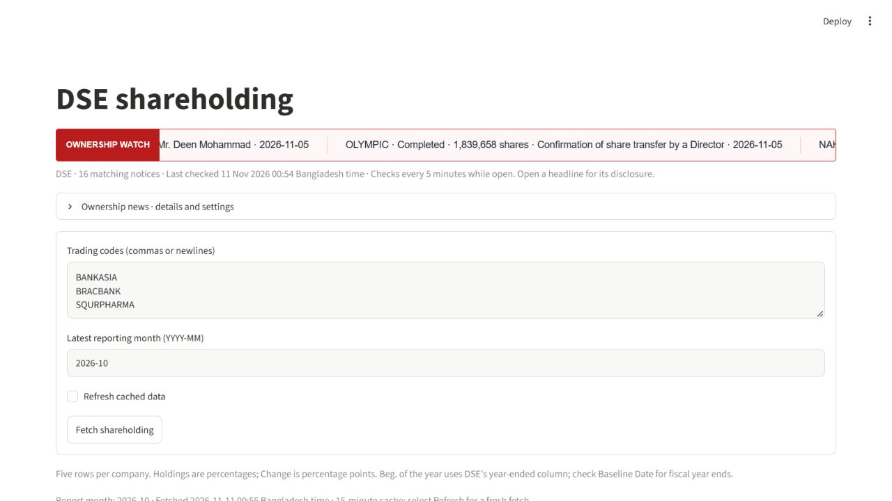
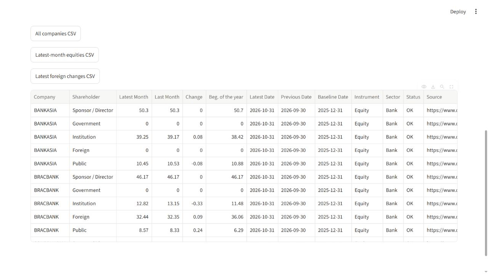
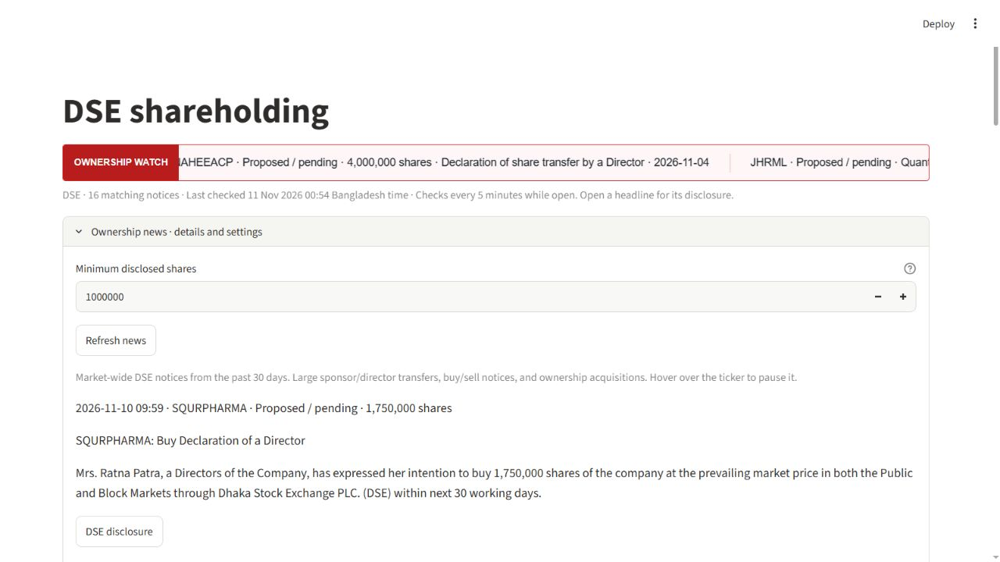

# DSE Shareholding Tracker

A Python and Streamlit app for comparing company shareholding reports from the Dhaka Stock Exchange.

Enter DSE trading codes to retrieve dated ownership figures, compare monthly changes, and export three CSV reports. The app also displays recent sponsor/director ownership announcements with links to the original disclosures.

## App preview

Screenshots captured on 11 November 2026. These are images of the application, not an interactive demo.

### Company input

### Results and exports

### Ownership announcements

## Implementation

Python, Streamlit, pandas, requests, Beautiful Soup, and PyInstaller.

The source code is maintained in a private repository. This public repository contains only the project description and screenshots; no source code or application downloads are provided.

Project by [Shayan Biswas](https://github.com/Shayan-Biswas).
